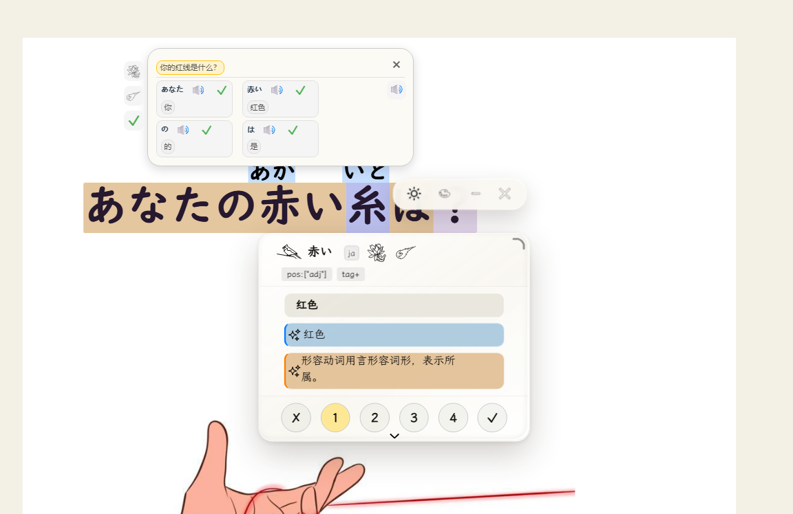
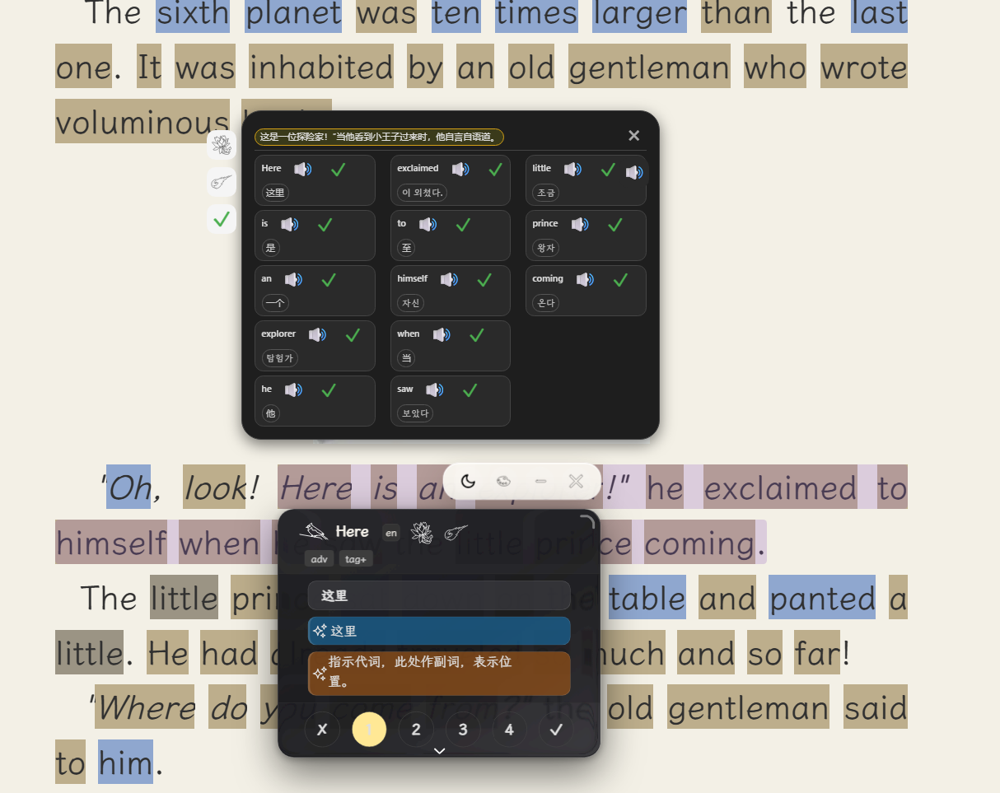
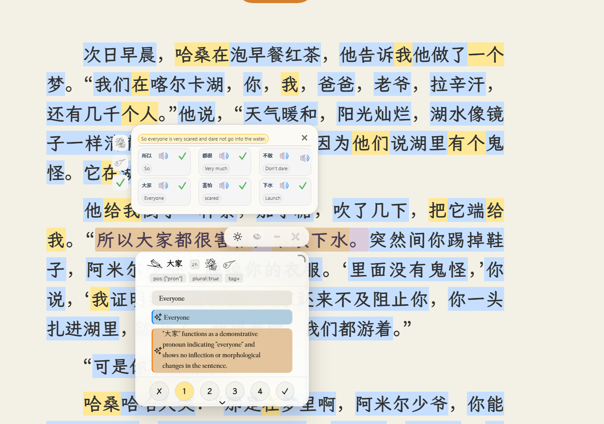
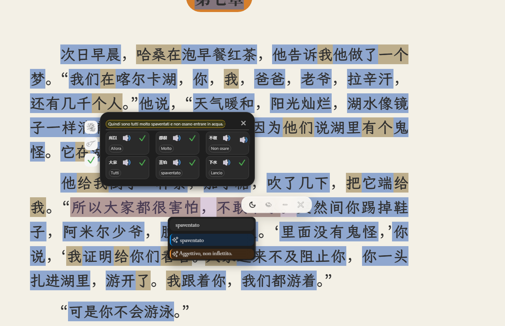
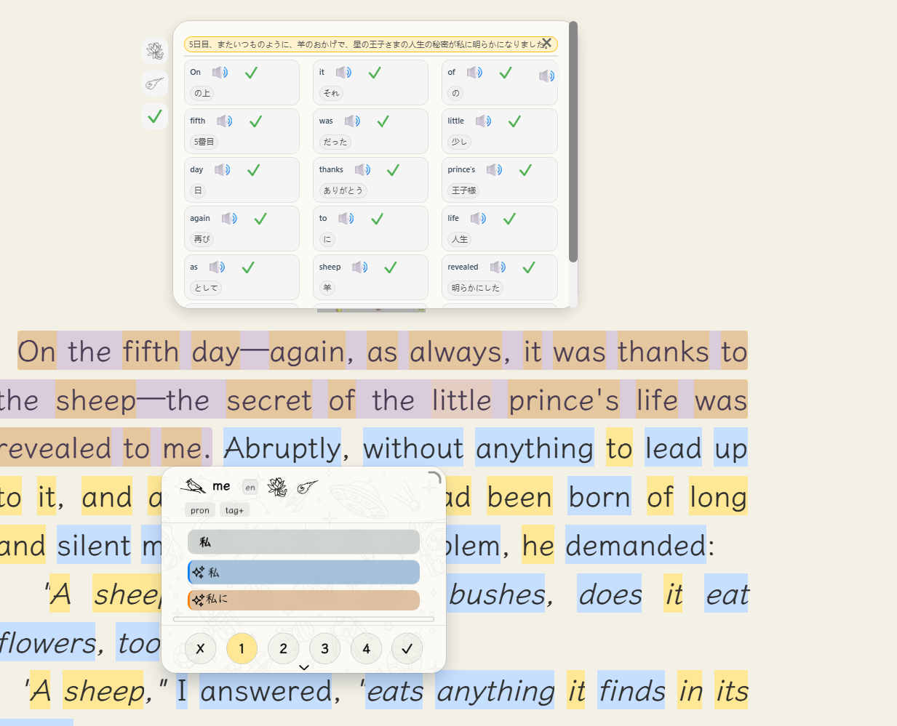

# LingKuma for Calibre

[English](../README.md) | [简体中文](README_zh.md) | [日本語](README_ja.md) | [한국어](README_ko.md)

**See it. Click it. Learn it.** 
**わからないところは、クリック。**

[LingKuma 本家](https://github.com/lingkuma/LingKuma) · [LingKuma Wiki](https://docs.lingkuma.org) · [LingKuma 公式サイト](https://lingkuma.org/) · [Zotero 移植版](https://github.com/white-ink-cell/lingkuma-zotero)

LingKuma —— *言語の壁を越えて、知識を広げるために* —— は、読書を中心に設計された翻訳・語学学習ツールです。

ある言語を「学び終える」まで、その言語の論文や本、文書を読むのを待つ必要はありません。

知らない単語に出会ったら、**クリック**。  
理解しにくい文に出会ったら、**クリック**。

LingKuma は、まだ学習途中の言語で書かれたコンテンツを読むことをサポートします。読書を楽しみながら自然に語彙を増やし、文法や表現に慣れ、その言語への理解を深めることができます。

> **まず読書を楽しみ、その過程で新しい言語を学ぶ。**

## LingKuma でできること

- 単語をクリックして意味を確認
- 文全体の翻訳と分析
- **Dictionary + Quick Context + AI Detail** による、より高速で正確な単語検索
- 辞書の実録音で単語の発音を再生し、米国英語 / 英国英語を個別に選択。録音がない場合は TTS を使用
- 読書中に語彙、意味、自分の学習記録を蓄積
- AI による文法、文脈、難しい文の解説
- Word Explosion で現在の文に含まれる複数の単語を確認
- カスタムボタンから外部辞書、検索エンジン、Wikipedia などの百科事典を開く
- Bionic Reading、Reading Ruler、POS Highlight
- オプションの WebDAV バックアップ / 復元
- ライト / ダークテーマ

より詳しい利用方法とプラットフォーム情報は [LingKuma Wiki](https://docs.lingkuma.org) を参照してください。

## スクリーンショット

<i>LingKuma in action across different languages and themes.</i>

<table>
  <tr>
    <td align="center" width="50%">
      
       
      <b>Japanese → Chinese</b> 
      Light mode
    </td>
    <td align="center" width="50%">
      
       
      <b>English → Korean</b> 
      Dark mode
    </td>
  </tr>
  <tr>
    <td align="center" width="50%">
      
       
      <b>Chinese → English</b> 
      Light mode
    </td>
    <td align="center" width="50%">
      
       
      <b>Chinese → Italian</b> 
      Dark mode
    </td>
  </tr>
</table>

 

 
<b>English → Japanese</b> 
Light mode

## Calibre 移植版

これはオープンソースプロジェクト LingKuma の非公式 Calibre 移植版です。

オリジナルの LingKuma には、単語のハイライト、文の翻訳・分析、語彙学習、音声読み上げ、Edge TTS などの機能がすでに備わっています。Calibre 移植版はこれらの主要機能を維持し、Calibre の独立した読書環境に適応させています。

Calibre 移植版では、主に次の対応を追加・調整しています：

- Calibre の電子書籍閲覧環境と統合し、独立した Qt WebEngine リーダーウィンドウで LingKuma を使用
- EPUB 閲覧、章のナビゲーション、読書進捗、ページ表示設定への対応
- EPUB 閲覧時の文選択と改行修復の改善
- より完全な文境界認識と文の再構築、日本語・韓国語の意味のある短文の認識
- 明示的な英語ハイフン複合語の認識
- Dictionary + Quick Context による高速な英単語検索
- Calibre に対応したすりガラス効果
- Calibre 内の LingKuma 設定画面に、言語、語彙、TTS、読書支援、データ管理などの設定を統合
- Calibre 実行環境における Edge TTS の再生、試聴、停止処理の修正

## v1.1.2 の主な更新

### Calibre の読書環境への対応

本リリースは **LingKuma 1.1.1** をベースに、Calibre 内での独立した読書体験をさらに改善しています。

LingKuma の読書、翻訳、学習、ツールチップのインターフェースは、引き続きオリジナルプロジェクトのデザインと機能を維持しています。Calibre アダプターは、電子書籍の解析、Qt WebEngine リーダーウィンドウ、章のナビゲーション、読書進捗、ブラウザー拡張の実行インターフェースとの互換性を担当します。

本リリースでは、言語設定、語彙管理、TTS の設定と試聴、読書支援、データ管理などの機能もさらに整備しました。

### より高速な検索：Dictionary + Quick Context + AI

以前は通常の単語の意味も AI に大きく依存していたため、単純な検索でも生成待ちが発生し、形容詞と後続の名詞が同じフレーズ全体として説明されるような曖昧な結果が出ることがありました。

現在は役割を三層に分けています：

1. **Dictionary（辞書）** — 基本的な意味、品詞、語形、IPA、発音メタデータなどの安定した語彙情報を高速に提供します。
2. **Quick Context（高速文脈翻訳）** — **現在の文全体**を使った高速な非生成型の文脈翻訳を行い、その文における選択した単語の意味を取り出します。
3. **AI Detail（AI 詳細解説）** — 文法、複雑な用法、文解析、さらに詳しい説明を引き続き担当します。

これにより、通常の単語検索が AI の生成速度に強く依存しなくなり、基本的な語彙情報の安定性を高めながら、AI による深い理解の支援も維持しています。

利用可能な意味がある場合、ユーザーは語彙管理画面で保存済みの意味を確認、編集、削除できます。異なる情報源の意味を無理に一つにまとめる必要はありません。

### Word Explosion の高速化

Word Explosion の各単語の短い意味は、通常経路では単語ごとの AI 応答を待たず、Quick Context を優先して使用します。すでに保存されている意味も維持します。

文全体の翻訳やより深い AI 分析は引き続き利用できます。

### 文選択と文境界の改善

本リリースでは、LingKuma が従来から備えている文処理機能を維持し、Calibre の EPUB 閲覧環境に合わせてさらに改善しています：

- EPUB の改行や複数のテキストノードにまたがる文選択を改善；
- 半文や誤って隣の文まで選択する問題を削減；
- 略語、頭文字、小数、引用符、括弧、コロン、セミコロンをより保守的に処理；
- EPUB のレイアウト上の改行による明らかなハイフン分割を修復；
- 日本語・韓国語の意味のある短文の認識を改善。

Calibre 移植版では PDF ファイルの自動変換や処理は行いません。PDF を読む場合は、オリジナルの LingKuma ブラウザー拡張を利用できます。

### ハイフン複合語

以前は、次のような語が誤って分割されることがありました：

- `well-known`
- `out-of-sample`
- `peer-on-peer`

現在は、こうした明示的な英語のハイフン複合語を、できるだけ一つの検索・学習単位として扱います。

一方、`inter-` + 改行 + `national` のようなレイアウト由来の分割は別ルールで扱い、明確な場合に `international` として保守的に修復します。

### 発音の改善：辞書音声 + IPA + 米国英語 / 英国英語

英単語の発音では、信頼できる辞書の発音データを優先します：

- 信頼できるデータがある場合、実際の語形に対応する IPA を表示；
- 米国英語 / 英国英語の発音を個別に表示し、それぞれ独立して再生；
- 辞書の実録音があれば優先；
- 実際の語形に録音がない場合は TTS を使用。

上部の単語発音ボタンは：

- 米国英語の録音のみ → 米国英語を再生；
- 英国英語の録音のみ → 英国英語を再生；
- 両方あり → **米国英語を既定**として再生；
- どちらもなし → TTS にフォールバック。

`books`、`worked`、`studies`、`working` などの活用形で特に有効です。

### Calibre における Edge TTS の修正

**Edge TTS はオリジナルの LingKuma にすでに備わっている機能であり、この移植版で新しく追加した音声プロバイダーではありません。**

本リリースでは、主に Calibre 実行環境との互換性に関する問題を修正し、音声合成、試聴、パラメーターの受け渡し、再生停止の処理を改善しました。必要な依存ライブラリとともに、内蔵の `edge-tts` クライアントを使用します。

Windows Calibre 9.16 への実際のインストールテストでは、ユーザーが次の動作を確認しています：

- Edge TTS の米国英語音声が正常に再生される；
- Edge TTS の英国英語音声が正常に再生される；
- 停止ボタンが正常に動作する。

Calibre の設定画面には、システムローカル音声、Edge TTS、GPT TTS の設定項目と試聴用コントロールも用意されています。各音声プロバイダーは、それぞれの設定とサービス要件に従って動作します。

### 読書・学習機能を維持

Calibre で利用可能な LingKuma の読書ワークフローを引き続き維持、または復元しています：

- 語彙状態と保存した意味；
- 例文・学習記録；
- AI 文解析と詳細な単語説明；
- Bionic Reading；
- Reading Ruler；
- POS Highlight；
- カスタム外部検索 / 辞書 / 百科事典ボタン；
- ローカル語彙管理；
- WebDAV バックアップ / 復元；
- EPUB の閲覧とテキスト修復；
- Calibre に対応したテーマとポップアップ動作；
- 章のナビゲーション、読書進捗、ページ表示設定。

## 現在の言語範囲

LingKuma 自体は多言語対応ですが、今回追加した**ローカル辞書による高速化は現在、主に英語ソーステキスト向け**です。

本リリースでは：

- 同梱ローカル辞書は **英語 → 簡体字中国語**；
- Quick Context は翻訳サービスが対応していれば設定した対象言語に従います；
- 他のソース言語でも、対応する翻訳機能や AI 機能を引き続き利用できます；
- 他のソース言語向けローカル辞書パックはまだ同梱していません。

そのため、本リリースで最も大きな速度・語義安定性の向上は**英語ソースの読書**で得られます。他のソース言語に対応するローカル辞書がなくても、既存の翻訳・AI 機能が失われるわけではありません。

## インストール

1. **[GitHub Releases](https://github.com/white-ink-cell/lingkuma-calibre/releases)** から `lingkuma-calibre-1.1.2.zip` をダウンロードします。
2. **Calibre → 設定 → プラグイン** を開きます。
3. **ファイルからプラグインを読み込む** を選択します。
4. ダウンロードした `lingkuma-calibre-1.1.2.zip` を選択します。
5. Calibre の案内に従ってインストールを確認し、Calibre を再起動します。

> GitHub が自動生成する `Source code (zip)` は Calibre プラグインとしてインストールしないでください。Release に添付されている `lingkuma-calibre-1.1.2.zip` プラグインパッケージを使用してください。

## その他のバージョン

- [LingKuma for Zotero](https://github.com/white-ink-cell/lingkuma-zotero)
- [LingKuma](https://github.com/lingkuma/LingKuma)

## 検証済みの環境

- **Windows x64**
- 必要な最低バージョン：**Calibre 9.16**
- Windows Calibre 9.16 / Python 3.14 環境で検証済み
- EPUB 閲覧に対応
- この移植版では PDF を自動変換・処理しません
- macOS と Linux は未検証で、互換性は確認できていません。

同梱の Edge TTS ネイティブ依存ライブラリは Windows AMD64 / Python 3.14 向けです。

## 設定

設定画面は Calibre に統合されています。

インストール後、Calibre 内の **LingKuma → 完全設定（完整设置）** から開きます。

言語・翻訳、AI Provider / プロンプト、語彙管理、Dictionary、ローカル / Edge / GPT TTS、ポップアップと読書支援、オプションの WebDAV バックアップ / 復元などを設定できます。

インターフェース言語と翻訳対象言語は個別に設定できます。インターフェース言語を変更しても、翻訳対象言語は自動的には変更されません。

## プライバシー

LingKuma for Calibre はローカル状態を Calibre のプラグインデータディレクトリに保存します。

翻訳、AI、リモート TTS、WebDAV の各機能では、選択した外部サービスの利用に必要なテキストまたはデータが送信される場合があります。

通常の単語検索や文の検索で、電子書籍全体を自動的にアップロードすることはありません。

## 上流プロジェクトとクレジット

- オリジナルプロジェクト：**[LingKuma](https://github.com/lingkuma/LingKuma)**
- LingKuma Wiki：**[docs.lingkuma.org](https://docs.lingkuma.org)**
- 上流バージョン：**LingKuma 1.1.1**
- Calibre 移植版のメンテナンスおよび公開：**white-ink-cell**

このリポジトリは LingKuma の非公式 Calibre 移植版です。

オリジナルプロジェクトの主要機能、インターフェース、アセット、デザインをできるだけ維持しながら、LingKuma を Calibre の読書環境へ適応させています。Calibre 固有の変更は、実行環境の互換性、文選択、Dictionary / Quick Context、発音の適応、複合語処理、すりガラス互換、多言語翻訳を中心としています。

詳細は [UPSTREAM.md](../UPSTREAM.md) を参照してください。

## 辞書データ

同梱英語辞書は **English Wiktionary** の投稿者データを **Wiktextract** で抽出し、**Kaikki.org** が配布するデータを元に生成しています。

辞書テキストデータは **CC BY-SA 4.0** で配布されます。リモートの Wikimedia Commons 発音ファイルは、それぞれの配布元ページに記載された個別ライセンスに従います。

詳細は `licenses/ENGLISH-WIKTIONARY-DATA-NOTICE.txt` と `THIRD-PARTY-NOTICES.txt` を参照してください。

## ライセンス

オリジナル LingKuma の作者表記、著作権、ライセンスは変更されていません。

Calibre アダプターおよび互換レイヤーには `licenses/LICENSE-ADAPTER.txt` のライセンスが適用されます。オリジナル LingKuma ライセンスは `LICENSE-LINGKUMA.txt` に保持され、同梱するサードパーティのライセンスと通知は `THIRD-PARTY-NOTICES.txt` に記録されています。
